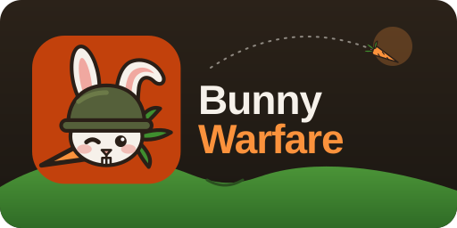

<p align="center"></p>

# BunnyWarfare

Rundenbasierte **3D-Artillerie mit Hasen**: Teams aus Hasen bekämpfen sich auf kleinen Inseln mit Karotten, Rüben und Kohlköpfen.
Allein gegen Bots oder mit Freunden über das Netz – im Browser, als Windows-App (später auch iOS/Android) und **offline**.

BunnyWarfare ist ein Spiel von **[MatGame](https://github.com/Real-TTX/MatGame)**, dem Master der Mat-Spiele: MatGame kümmert sich um Konten, Gäste,
die Anmeldung der Apps, das Portal und die Administration; BunnyWarfare steckt als Plugin darin.

- **Spiel für Spieler: komplett 3D** – Hauptmenü, Anmeldung (Konto oder Gast), Online-Lobbys, Neues Spiel, Rangliste, Profil und das Spiel selbst laufen in einer Vollbild-App über einer lebenden Insel (three.js, Cartoon-Look). Der Server rechnet jeden Schuss (keine Schummelei im Browser), Echtzeit über SignalR.
- **Online und offline:** im Browser auf einem MatGame-Server (`/bunnywarfare/`); in der App gegen den voreingestellten Server, einen selbst eingetragenen – oder ganz ohne Netz gegen Bots, mit eigenem Fortschritt auf dem Gerät.
- **Welten mit Details:** natürliche Küsten mit Stränden und Klippen, animiertes Wasser mit Schaum, Gras im Wind, Bäume, Häuser, Höhlen, ein Dschungeltempel, Tiere, Wolken – kein sichtbarer Kartenrand; Deko wird von Explosionen zerstört.
- **Profil, Level und Kleiderschrank:** Jedes fertige Spiel bringt XP (mehr für Siege, K.O. und Schaden; wer sofort aufgibt, bekommt nichts), bis Level 30. Mit Leveln, Siegen und K.O. werden Felle, Hüte, Gesichter und Porträtrahmen frei – teils richtig wild 🔥. Gäste spielen mit, landen aber nicht in der Rangliste; aus einem Gast wird mit einem Klick ein Konto.
- **Multiplayer:** Lobby mit Einladungslink, 2–8 Teams, Bots in drei Stärken, Zuschauen, Chat, Rangliste.
- **Waffen:** Karottenwerfer (Wind), Rübengranate (springt, Zünder), Kohlkopf-Splitter (Bomblets), Löwenzahn-Flinte (Schrot), Möhrenregen (Luftschlag), aus Kisten: Goldene Riesenmöhre und Hasenloch (Teleporter).
- **Versorgungskisten:** alle paar Runden fällt eine Kiste vom Himmel – mit Munition, Leben, Panzerfell, Doppel-Wumms oder Turbo-Möhre. Waffenkisten explodieren, wenn man sie trifft.
- **Administration** in MatGame unter `/Admin` → BunnyWarfare: Übersicht, Spieler (Team, XP, Look), Spiele (beenden, löschen), Welten (mit Vorschau), Waffen, Einstellungen und der **Import** eines alten BunnyWarfare-Servers.

Stack: .NET 10 (Razor Class Library, SignalR), PostgreSQL 17 (EF Core, Schema `bunnywarfare` in der Datenbank von MatGame), three.js r187.

## Starten

BunnyWarfare läuft in MatGame. Beide Repositories liegen nebeneinander:

```bash
git clone https://github.com/Real-TTX/MatGame.git
git clone https://github.com/Real-TTX/BunnyWarfare.git
cd BunnyWarfare
./scripts/redeploy.ps1          # baut und startet den lokalen MatGame-Stack mit allen Spielen -> http://localhost:2770/bunnywarfare/
```

**Windows-App:** `BunnyWarfare.exe` aus dem Release [release-channel](https://github.com/Real-TTX/BunnyWarfare/releases/tag/release-channel)
(Nightly: [nightly-channel](https://github.com/Real-TTX/BunnyWarfare/releases/tag/nightly-channel)) herunterladen und starten. Sie installiert sich selbst ins Startmenü
(ohne Administrator), spielt **offline** gegen Bots und online auf dem eingestellten MatGame-Server und aktualisiert sich bei neuen Versionen.

Auf einem Server: das Image von MatGame (`ghcr.io/real-ttx/matgame:latest`, Nightly `:nightly`) – siehe MatGame. Das **erste Konto** auf einem frischen MatGame wird Administrator.

**Umzug von einem alten BunnyWarfare-Server** (vor MatGame): in MatGame unter Administration → BunnyWarfare → Import die Verbindung zur alten Datenbank eintragen
(oder beim Start `MATGAME_IMPORT_BUNNYWARFARE` setzen). Konten (mit ihren alten Passwörtern), Fortschritt, eigene Welten und Waffen und die beendeten Spiele kommen mit.

## Steuerung

| Taste | |
|---|---|
| `W` `A` `S` `D` | laufen (Ausdauer pro Zug) |
| Maus ziehen / Mausrad | Kamera drehen (= zielen) / zoomen |
| `↑` `↓` oder `R` `F` | Rohr heben / senken |
| `Leertaste` halten | Kraft laden – loslassen feuert |
| `1`–`9` | Waffe wählen; Luftschlag und Hasenloch: Ziel anklicken |
| `V` | Vogelperspektive |
| `Tab` / `Enter` | Zug beenden / Chat |

## Versionen und Branches

| Branch | Version | Wohin |
|---|---|---|
| `main` | `<major>.<minor>.<build>-<datum>` z. B. `0.1.42-20261117` | in `ghcr.io/real-ttx/matgame:latest` |
| `dev` | `nightly-<build>-<datum>` | in `ghcr.io/real-ttx/matgame:nightly` |
| lokal | `local-<datum>` | der lokale MatGame-Stack |

Major/Minor stehen in `Directory.Build.props`, die Build-Nummer kommt aus GitHub Actions (`.github/workflows/build.yml`: bauen, testen, dann MatGame Bescheid geben –
dafür braucht es das Secret `MATGAME_DISPATCH_TOKEN`). Dort steht auch der voreingestellte Server der Apps (`MatGameDefaultServer`).

## Aufbau

```
src/BunnyWarfare.Core     die Spielregeln ohne Server: Insel, Physik, Bots, Kisten, das Spiel im Speicher, Kleiderschrank, die mitgelieferten Welten und Waffen
src/BunnyWarfare.Module   das Plugin für MatGame: API, Hub, Datenbank, Administration und die Spieler-App (wwwroot, unter /bunnywarfare/)
src/BunnyWarfare.Local    das Spiel offline in der App: dieselben Aufrufe, dasselbe Regelwerk, Profil als Datei auf dem Gerät
src/BunnyWarfare.App      die Windows-App (MatGame-Hülle mit Spieler-App und Offline-Spiel)
tests/BunnyWarfare.Tests  Simulation, Rundenlogik, Berechtigungen, Konten, das Offline-Spiel
docs/PROTOCOL.md          das Protokoll zwischen Spieler-App und Server (online und offline)
```

## Logo

`node scripts/logo.js` schreibt das Logo in allen Detailstufen (Favicon, Mark, Maskable, Mono, Wortmarke hell/dunkel, Hero) nach `docs/logo` und `wwwroot/img/logo`;
`./scripts/icons.ps1` zeichnet daraus die PNG-Icons (Edge headless).

<p>  </p>
